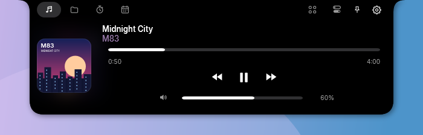
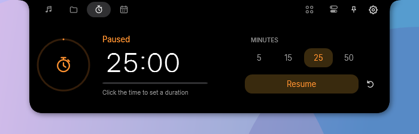
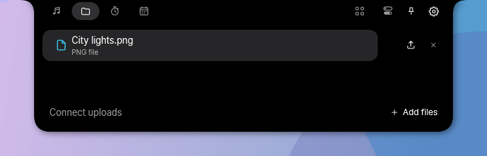
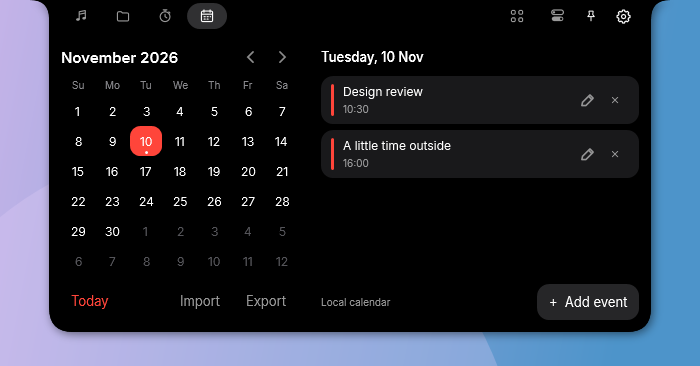
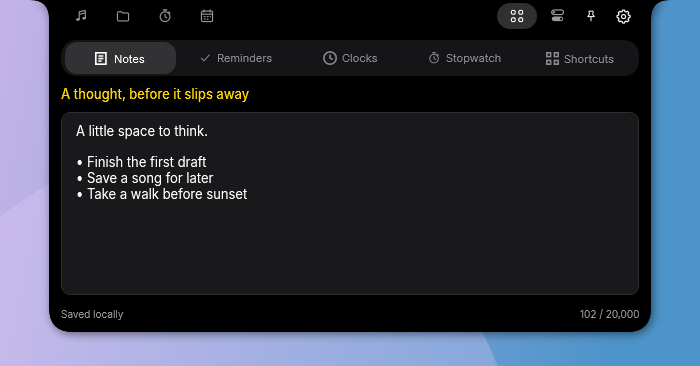
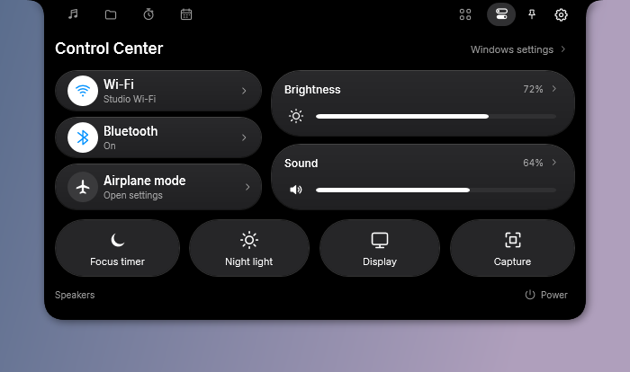

# Winisland — Dynamic Island and macOS notch for Windows

**Your music, files, and day. One notch.**

Winisland is a free, open-source **macOS-style notch for Windows 11 and Windows 10**. Control music, keep files close, run a focus timer, and check your calendar from a small panel at the top of your screen. It also offers an optional **Dynamic Island for Windows** appearance, built with native C# / WPF.

<p align="center">
  <a href="https://github.com/6fmh/winisland/releases/latest"></a>
  <a href="https://github.com/6fmh/winisland/actions/workflows/build.yml"></a>
  <a href="LICENSE"></a>
</p>

<p align="center">
  
</p>

<p align="center">
  <a href="https://github.com/6fmh/winisland/releases/latest"><strong>Download for Windows</strong></a> ·
  <a href="#features">Features</a> ·
  <a href="#screenshots">Screenshots</a> ·
  <a href="#getting-started">Getting started</a> ·
  <a href="#build-from-source">Build from source</a> ·
  <a href="https://github.com/6fmh/winisland/issues">Report an issue</a>
</p>

> **Feature availability:** The optional Dynamic Island appearance requires **v0.6.0 or later**. Windows notification previews require **v0.5.0 or later**. Check the [release notes and downloads](https://github.com/6fmh/winisland/releases) for the version you install.

## MacBook notch and Dynamic Island for Windows

Hover to expand. Click to pin it open. Move away to return to the compact notch. Music, timer, and upload activity stay visible at a glance; fullscreen hiding and reduced motion are available in Settings.

<p align="center">
  
</p>

The default silhouette follows the MacBook's inward-curved top shoulders and rounded lower corners. The expanding panels are Winisland's software features, inspired by projects such as [Boring Notch](https://github.com/TheBoredTeam/boring.notch). Apple's physical camera housing is the visual reference.

Choose **Settings → Appearance → Notch style → Dynamic Island** for an iPhone-inspired floating pill, compact music and a separate timer activity, and an expanded music player. The **…** menu keeps your other controls close by. **MacBook notch** remains the default, and switching back restores your saved MacBook dimensions. [Design references and measurements](docs/apple-dynamic-island-geometry-research.md).

## Features

| Feature | What you can do |
| --- | --- |
| **Music controls** | See album art, title, and artist; play/pause, skip tracks, and seek using Windows media sessions. Watch a live audio spectrum in the compact notch. |
| **Player volume** | Adjust supported players' own volume. Connect the Chromium browser companion or Spotify; Windows system sound has its own Control Center slider. |
| **File shelf** | Drop files or folders onto the notch, open them, and drag them into another app. Connect your own HTTPS upload server to share files and copy links. |
| **Focus timer** | Pick a preset or type a custom duration. Pause, resume, and follow the countdown while music keeps playing. |
| **Calendar** | Browse months, manage local agenda events, and import or export `.ics` files. |
| **Everyday tools** | Save quick notes, set reminders, check world clocks, and use a stopwatch with laps. |
| **Control Center** | Access Wi-Fi, Bluetooth, supported display brightness, system volume, and Windows settings shortcuts. |
| **Windows notifications (v0.5.0+)** | Preview incoming visible Windows notification banners with an app icon, title, and message. Windows controls sound and Do Not Disturb. [Notification setup and limits](docs/NOTIFICATIONS.md). |
| **Apple accessory connections** | See connection moments for supported Apple accessories, including AirPods. Device names and model details depend on the metadata Windows exposes. |
| **Desktop preferences** | Choose the default MacBook notch or optional Dynamic Island, select a display, adjust MacBook notch size and hover behavior, enable reduced motion, and hide the notch for fullscreen apps. Laptops also show battery status. |
| **Built-in updates** | See new stable releases in the notch, download with progress, and choose **Update and restart**. |

## Screenshots

<table>
  <tr>
    <td width="50%"><strong>Focus timer</strong><br><br></td>
    <td width="50%"><strong>File shelf</strong><br><br></td>
  </tr>
  <tr>
    <td width="50%"><strong>Local calendar</strong><br><br></td>
    <td width="50%"><strong>Notes and tools</strong><br><br></td>
  </tr>
</table>

<details>
<summary><strong>See Control Center</strong></summary>

<p align="center">
  
</p>

Radio toggles depend on Windows permissions and adapter support. Brightness controls supported built-in displays; external monitors use their own controls. Shortcut buttons open the corresponding Windows controls.

</details>

*Screenshots show the actual WPF interface rendered with sample media, files, calendar events, and device states on an isolated verification desktop. Backgrounds and album artwork are test illustrations. [Image sources and research](docs/README-RESEARCH.md).*

## Download and install

1. Open the [latest Windows release](https://github.com/6fmh/winisland/releases/latest).
2. Download the **`Winisland-Setup-…-win-x64.exe`** installer.
3. Run it, choose your shortcut and startup preferences, and launch Winisland.

**Requirements:** Windows 11 or Windows 10 version 2004 or later, on an x64 PC. The installer includes the .NET runtime and installs for your Windows account without administrator rights. The current installer is unsigned; each release includes a `.sha256` checksum file.

Startup at sign-in is enabled by default in the installer and can be turned off during setup or in Settings. Settings open on the first direct launch. Closing Settings leaves the notch running.

<details>
<summary>Installer preferences and uninstall behavior</summary>

The installer disables Windows 11's **Drop tray** so it does not cover the notch while you drag files. Recent Windows builds put this setting under **Settings → System → Multitasking → Drop tray**; older builds use **Nearby sharing**. Uninstall restores the previous value unless you changed it afterward.

Updates preserve settings, notes, file references, encrypted connections, and your startup preference. Uninstall retains your local data in `%LOCALAPPDATA%\Winisland`.

</details>

## Getting started

Hover over the notch to open it, then choose an activity from the header or Dynamic Island's **…** menu. Click to pin it open for keyboard input. **Esc** closes a pinned panel; double-click the tray icon to open Settings. Quit from the tray menu's **Quit Winisland** action.

| Shortcut | Action |
| --- | --- |
| **Ctrl+Alt+N** | Toggle the notch |
| **Ctrl+Alt+S** | Open Settings |
| **Ctrl+1–6** | While pinned: music, files, focus, calendar, tools, Control Center |
| **Ctrl+7** | While pinned: Software update |
| **Middle-click the notch** | Play/pause music |
| **Esc** | Close a pinned panel, or cancel the active text edit |

### Music controls for Spotify and Chromium browsers

Start playback in an app that exposes a Windows media session. Winisland shows the available playback controls; support for seeking and track changes depends on the player.

For **Comet, Chrome, Edge, Brave, and compatible Chromium browsers**, open **Settings → Player controls** and follow the companion-extension instructions. Load the bundled folder from the browser's extensions page and reload already-open media tabs. The companion connects locally and controls supported HTML5 and YouTube players. [Browser companion installation and permissions](src/Winisland/Assets/BrowserExtension/README.md).

**Spotify desktop** can use its accessible volume control when available; some versions expose 10% steps. Optional Spotify account integration supports 1% changes and requires Premium plus a Spotify developer app. [Player volume and Spotify setup](docs/player-volume.md).

### File shelf and ShareX uploads

Drop files or folders onto the notch to keep them in the shelf. The shelf stores references to your originals; removing an item leaves the original file untouched.

To upload files, open **Settings → Uploads** and enter your server's **HTTPS upload URL** with an optional Bearer token, or import a compatible ShareX `.sxcu` uploader. **No upload server is preconfigured.** Once connected, dropped files upload and show progress, copy-link, retry, and cancel controls. Folders stay local.

Each file is limited to **90 MB**; your host may impose a lower limit. ShareX import supports multipart file uploads, static headers and form fields, and supported JSON response paths. Unsupported configurations show a setup error.

### Timer, calendar, and tools

Click the timer's countdown and enter minutes (`45`), `mm:ss` (`25:00`), or `h:mm:ss` (`1:30:00`). Press Enter to apply. Custom durations range from one second to 24 hours.

Use Calendar for local events and `.ics` import/export. Tools contains notes, reminders, world clocks, stopwatch, and shortcuts. Notes save automatically. [Organizer features and limits](docs/ORGANIZER.md).

### Updates

Winisland checks this repository's stable GitHub releases on startup and every 30 minutes. When an update appears, choose **Update and restart** in the Software update tab. You can cancel during download.

Check manually from the tray menu, **Settings → About**, or **Ctrl+7** while pinned. [Update and startup details](docs/UPDATES.md).

### Windows notification previews

In **v0.5.0 or later**, enable **Settings → Activities → Notifications on the notch** to show incoming visible Windows banners. Dismiss closes the notch preview; click the preview to open its source when a supported action is available. Notification Center history is not replayed. [Setup, privacy, and troubleshooting](docs/NOTIFICATIONS.md).

## Privacy and local data

- **No telemetry or saved playback history.** Audio visualization analyzes output in memory, without microphone access or saved recordings.
- **Local storage.** Settings, notes, file references, and logs live in `%LOCALAPPDATA%\Winisland`. Upload connections and Spotify refresh tokens use Windows DPAPI encryption for your account.
- **Your upload destination.** Files leave your PC when an upload runs against the server you configured. Removing a shelf item does not delete a hosted file.
- **Local browser bridge.** The companion uses native messaging, makes no network requests, and saves no browsing history. Release checks contact GitHub; optional Spotify account integration contacts Spotify.
- **Notification privacy.** Incoming notification previews stay in memory; their message content is not saved to files or diagnostic logs.

## Compatibility and common questions

### Is Winisland free and open source?

Yes. Winisland uses the [MIT license](LICENSE). You can download it, inspect the C# / WPF source, and contribute improvements.

### Does it work on a desktop PC without a physical notch?

Yes. Winisland draws a software overlay at the display's top edge. You can select the display and adjust its size in Settings. It does not reserve screen space, so fullscreen hiding is useful for games and video.

### Can I use Dynamic Island on Windows 10 and Windows 11?

The current source supports both through **Settings → Appearance → Notch style → Dynamic Island**. This appearance awaits a tagged release; build from source to try it. It is a Windows software overlay, and no Apple hardware is required.

### Why is player volume unavailable?

Player volume needs a supported local control, browser companion, or Spotify connection. Open **Settings → Player controls**. The music slider does not fall back to changing Windows mixer levels; use Control Center's system sound slider for Windows output volume.

### Does it include macOS services?

Its calendar is local, with no calendar-account sync. AirDrop, Continuity, phone mirroring, webcam preview, and external-monitor brightness are outside the current feature set. Supported notification previews observe visible Windows banners; they do not provide notification history or a general notification subscription API. Timer state resets when the app exits.

### Can I use Windows on ARM?

The build scripts support `win-arm64`, but the published, verified installer is x64. Native ARM64 builds need verification on an ARM64 machine.

## Build from source

Use Windows and the .NET 8 SDK. The build script can download the SDK into the repository's ignored `.tools/` directory when needed.

```powershell
git clone https://github.com/6fmh/winisland.git
Set-Location winisland
.\scripts\Build.ps1 -PrivateBuild -Verify
```

`-Verify` publishes a separate candidate and runs native checks on a **private Windows desktop**, keeping the interactive desktop and an existing Winisland instance undisturbed. JSON reports and rendered PNGs are written under `artifacts/verification/`.

This creates a personal candidate with public update checks disabled. To run that verified candidate yourself:

```powershell
Start-Process -FilePath .\artifacts\verification\candidate\private\win-x64\Winisland.exe -ArgumentList '--background' -WindowStyle Hidden
```

The portable candidate requires the [.NET 8 Desktop Runtime (x64)](https://dotnet.microsoft.com/en-us/download/dotnet/8). See the [contributing and verification guide](CONTRIBUTING.md) for the source layout, public builds, and background checks.

<details>
<summary>Self-contained builds, installers, and additional checks</summary>

Include the runtime in a standalone build:

```powershell
.\scripts\Build.ps1 -PrivateBuild -SelfContained -Verify
```

Build and verify the installer payload with [Inno Setup 6](https://jrsoftware.org/isdl.php):

```powershell
.\scripts\Build-Installer.ps1 -Verify
```

Installer output and checksums go to `dist/installer/`. Use `-CompilerPath` for a custom `ISCC.exe` location, or `-Runtime win-arm64` to target ARM64. Verification requires the matching host architecture.

Verify an existing candidate using `scripts/Invoke-Verification.ps1 -ExecutablePath <Winisland.exe> -OutputDirectory <artifacts-directory>`. Isolation failures write a report and stop; verification never falls back to the interactive desktop.

Full install, upgrade, rollback, and uninstall checks change registry and shell settings. Run `scripts/Verify-Installer.ps1 -InstallerPath <setup.exe> -AllowDesktopChanges` only in a **disposable Windows VM**. GitHub Actions runs that lifecycle gate alongside native app and payload checks.

Browser safety checks run with `node scripts/Verify-BrowserSafety.mjs`. See [background verification guidance](CONTRIBUTING.md#verify-your-change) before running checks.

</details>

## Documentation and contributing

Maintained by [6fmh](https://github.com/6fmh). Bug reports and contributions are welcome.

- [Report a bug or request a feature](https://github.com/6fmh/winisland/issues). Include your Windows version, Winisland version, what you expected, and steps to reproduce.
- Submit pull requests against `main`. Follow the [contributing guide](CONTRIBUTING.md) and include relevant verification evidence for code changes.
- Read the [design specification](docs/NOTCH-DESIGN.md), [Windows Control Center guide](docs/CONTROL-CENTER.md), [calendar, notes, and organizer guide](docs/ORGANIZER.md), [Spotify and browser volume guide](docs/player-volume.md), [Windows notifications guide](docs/NOTIFICATIONS.md), and [update guide](docs/UPDATES.md).
- Check the [latest release notes](https://github.com/6fmh/winisland/releases/latest).

## Credits and license

Winisland uses the [MIT license](LICENSE). Bundled dependencies and fonts retain their [third-party notices](THIRD-PARTY-NOTICES.md).

Apple's [MacBook imagery](https://www.apple.com/macbook-air/) and [camera-housing guidance](https://support.apple.com/en-us/102125) inform the silhouette. [Boring Notch](https://github.com/TheBoredTeam/boring.notch), [NotchNook](https://lo.cafe/notchnook), and [DynamicLake](https://www.dynamiclake.com) are interaction references. Typography uses bundled Inter under the SIL Open Font License; icons are original vector drawings.

Winisland is an independent project and is not affiliated with Apple. No Apple product artwork, SF Symbols assets, or San Francisco font files are bundled. [Design research and fidelity limits](docs/NOTCH-DESIGN.md).
